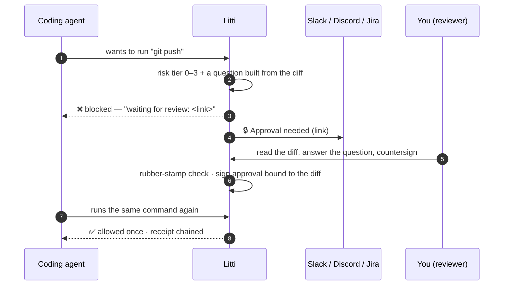

<div align="center">

<picture>
  <source media="(prefers-color-scheme: dark)" srcset="docs/brand/logo/litti-horizontal-dark.svg">
  
</picture>

### Proof that a human actually read what their AI agent is about to ship.

[](https://github.com/Abhishek764/litti/actions/workflows/ci.yml)
[](LICENSE)
[](https://nodejs.org)
[](CONTRIBUTING.md)

[Quick start](#quick-start) · [How it works](#how-it-works) · [Use it with Claude Code](#use-it-with-your-coding-agent) · [Slack, Discord, Jira](#tell-your-team) · [Docs](docs/guide/index.md)

</div>

---

**Your approve button is a spring lock. Litti makes sure someone turned the key.**

Developers approve almost every permission prompt their coding agent shows them, often without reading. Litti sits between the agent and anything risky (a commit, a push, a deploy, a migration, a big delete) and makes a human **prove they understood the change** before it runs. Every decision lands in a tamper-evident receipt.

Other approval tools prove someone clicked. Litti proves they read it.

<table>
<tr>
<td width="33%" valign="top">

**🛑 Stops risky actions**<br>
Tests, builds and edits run freely. Commits, pushes, deploys and deletes wait for a review.

</td>
<td width="33%" valign="top">

**🧠 Proves comprehension**<br>
Each review asks a question built from the diff itself, and the kind of question changes every time.

</td>
<td width="33%" valign="top">

**🔏 Leaves evidence**<br>
Approvals are bound to the exact diff and chained into receipts anyone can verify.

</td>
</tr>
</table>

---

## Quick start

You need **Node.js 20.10+**.

```bash
npm install -g litti
litti
```

That's it. Your browser opens Litti with a **Get started** guide. Keep the terminal open while you work.

<details>
<summary>Just want to look around first?</summary>

```bash
litti demo
```

Starts Litti with three sample changes (a CSS tweak, a database migration, a destructive cleanup). Review them, then try answering wrong on the dangerous one and watch Litti block it.

</details>

Settings and data live in `~/.litti/`. A secret key is created for you on first run.

---

## How it works



| Risk tier | Example | Reviewers |
|---|---|---|
| 0 | Read files, run tests | none, runs instantly |
| 1 | A normal commit | 1 |
| 2 | Touches `migrations/`, `auth/`, `.env`; diffs over 200 lines; can't be undone | 2 |
| 3 | `DROP TABLE`, `rm -rf`, force-push, deletes | 3 |

Each review asks one of six kinds of question, chosen at random and never the same kind twice in a row:

| | The reviewer… |
|---|---|
| **Quiz** | picks the right fact from 4 options |
| **Spot the line** | clicks the line that does the risky thing |
| **Recall** | types the table, function or value from memory |
| **Canary** | spots whether a line was quietly altered |
| **Count** | says how many lines were added or removed |
| **Explain it** | writes one sentence in their own words, saved in the receipt |

Approve too fast, or answer wrong, and Litti calls it a **rubber-stamp**: blocked, announced, every review on that action reset, and the next action gets a stricter tier.

---

## Use it with your coding agent

Inside the project your agent works on:

```bash
cd my-project
litti install claude      # Claude Code   (also: codex, opencode, all)
```

Restart the agent. Now ask it to change something and commit:

1. It edits files and runs tests. **Nothing is blocked.**
2. It tries `git commit` and is **blocked with a review link**.
3. You open the link, read the change, answer the question and **Countersign**.
4. You tell the agent "approved". It runs the same commit again and **it goes through, once**.

If the code changes after approval, that's a new review. If Litti isn't running, risky commands stay blocked: a gate that fails open isn't a gate.

| Agent | What `litti install` writes |
|---|---|
| Claude Code | `.claude/settings.json`: a `PreToolUse` hook on Bash |
| Codex | `.codex/hooks.json`: a `PreToolUse` hook ([may need enabling](https://developers.openai.com/codex/hooks)) |
| OpenCode | `.opencode/plugin/litti.ts`: blocks in `tool.execute.before` |

> 💡 Give your agent the rules in [docs/agent-instructions.md](docs/agent-instructions.md) (paste into `CLAUDE.md` / `AGENTS.md`) so it waits for review instead of looking for workarounds.

Any other agent or pipeline can use the [`litti` CLI](docs/guide/cli.md) or the [HTTP API](docs/guide/api.md).

---

## Tell your team

Open **http://127.0.0.1:3847/integrations** and click **Connect**:

| | One click | Or |
|---|---|---|
| **Slack** | Connect → pick a channel → Allow | Paste an incoming-webhook link |
| **Discord** | Connect → pick a server and channel → Authorize | Paste a channel webhook link |
| **Jira** | Connect → sign in → pick your site and project | Use your own Atlassian app |

Every risky action posts a card with a **Review** button. Jira gets an issue per action, a comment per review step, and is closed on approval. Nobody can approve from chat: the button always opens the review page.

Only metadata is sent (description, file names, risk reasons, the diff's hash). **Your code never leaves your machine.** Tokens are stored encrypted.

<sub>One-click connect uses [Litti Connect](docs/connect-service.md), a small stateless service holding Litti's registered apps. If the button is greyed out, one-click isn't switched on for your install yet: use the **Or** column (under *Other ways to connect*), which works everywhere.</sub>

---

## Watch and discuss changes

Open **http://127.0.0.1:3847/changes** while your agent works. You see its changes live, and you can comment on any line:

> *"Why multiply by 100 here? Callers already pass cents."*

The agent answers in the same thread (`litti notes`, `litti reply`), and **Request review** turns the whole change into a Litti review.

---

## Everyday commands

```bash
litti                        # start and open the dashboard
litti demo                   # sample reviews to try
litti install claude         # gate an agent in this project
litti pending                # what's waiting for review
litti status <id>            # approved yet?
litti review <id> --as ana   # a personal review link for one reviewer
litti notes                  # reviewer comments on the agent's changes
litti verify                 # check the receipt chain for tampering
litti stats                  # reviewer attention scores
```

---

## What Litti guarantees

| Guarantee | How |
|---|---|
| Nothing risky runs without approval | Agent hooks deny at once; the executor refuses without a valid, unused token |
| You can't approve your own request | The requester is excluded; each reviewer counts once |
| You can't fake reading | Time measured by the server, scroll check, a check built from the diff |
| You can't swap the code after approval | The approval is bound to the SHA-256 of the exact diff |
| You can't replay an approval | Approvals are single use |
| You can't quietly edit history | Hash-chained receipts; `litti verify` points at the first broken link |
| Rubber-stamping has a cost | Blocked, announced, reviews reset, next action stricter |
| No AI in the trust path | Tiers and questions come from rules, not a model. The same diff always gets the same tier |

Threat model and deployment notes: [SECURITY.md](SECURITY.md).

---

## Run it for a team

```bash
docker compose up -d
```

Put it behind your SSO proxy, set `LITTI_API_KEY`, `LITTI_ADMIN_KEY` and `LITTI_IDENTITY_HEADER`, and reviewers' names come from their login. Approved actions can be handed to your CI/CD through a signed webhook. Step by step: [Run Litti for your team](docs/guide/team-setup.md).

---

## Documentation

Run Litti and open **http://127.0.0.1:3847/docs**, or read it here:

| Learn | Understand | Look up |
|---|---|---|
| [Install](docs/guide/install.md) | [How Litti works](docs/guide/how-it-works.md) | [CLI](docs/guide/cli.md) |
| [Lesson 1: your first review](docs/guide/first-review.md) | [Risk tiers](docs/guide/risk-tiers.md) | [HTTP API](docs/guide/api.md) |
| [Lesson 2: gate your coding agent](docs/guide/connect-agent.md) | [Comprehension checks](docs/guide/checks.md) | [Configuration](docs/guide/config.md) |
| [Lesson 3: talk it through](docs/guide/changes.md) | [Tokens and receipts](docs/guide/receipts.md) | [Troubleshooting](docs/guide/troubleshooting.md) |
| [Lesson 4: Slack, Discord, Jira](docs/guide/connect-team.md) | [Architecture roadmap](docs/architecture.md) | [Run Litti for your team](docs/guide/team-setup.md) |

---

## Development

```bash
git clone https://github.com/Abhishek764/litti.git
cd litti
npm install
npm run demo     # run from source
npm test         # typecheck + every test suite
npm run build    # compile to dist/ (what npm publishes)
```

Node.js + TypeScript · Fastify · SQLite (better-sqlite3) · Node `crypto` · plain HTML/CSS/JS, no frontend framework.

## Contributing

Issues and PRs are welcome. New question templates, tiering rules and agent integrations make great first contributions. Start with [CONTRIBUTING.md](CONTRIBUTING.md), and report security bypasses privately via [SECURITY.md](SECURITY.md). Logo and colours: [docs/brand](docs/brand/README.md).

## License

[MIT](LICENSE)
