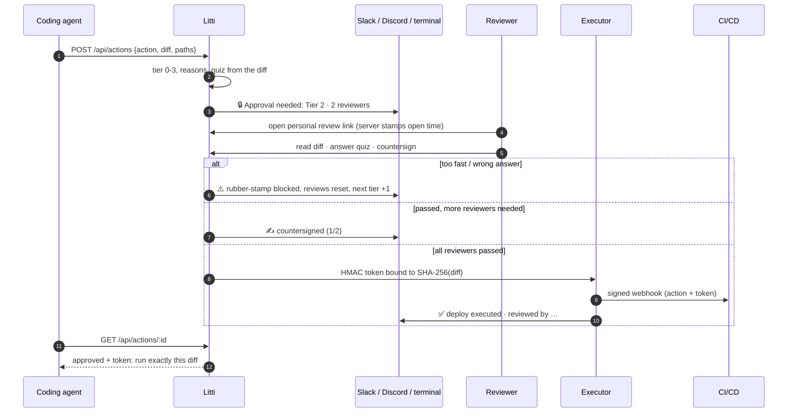

<div align="center">

<picture>
  <source media="(prefers-color-scheme: dark)" srcset="docs/brand/logo/litti-horizontal-dark.svg">
  
</picture>


[](https://github.com/Abhishek764/litti/actions/workflows/ci.yml)
[](LICENSE)
[](CONTRIBUTING.md)

</div>

**Your approve button is a spring lock. Litti makes sure someone turned the key.**

> Developers approve 93% of AI coding agent permission prompts. At that rate, Allow is just a slower Continue.

Litti is **proof of review** for AI coding agents. When an agent wants to do something risky
(run a migration, deploy, delete data, touch auth), it asks Litti first. Litti works out how risky
the action is, asks the right number of teammates to review it, makes each reviewer **prove they
read the diff**, and only then lets the action run. Every decision is written to a tamper-evident
receipt chain.

Other approval tools prove someone clicked. Litti proves they understood.

- **No LLM in the trust path.** Quizzes are generated deterministically from the diff. Your code never leaves your machine.
- **Self-hosted.** One Node process and a SQLite file. Docker image included.
- **Works with any agent.** HTTP API and a `litti` CLI. Approval cards go to your terminal and to Slack or Discord via webhook.

---

## How it works



## What Litti checks

1. **Risk tier (0–3)** from deterministic rules: critical paths (`migration`, `auth`, `prod`, `.env`…), diff size, destructive commands (`DROP`, `DELETE FROM`, `rm -rf`, `git push --force`), irreversibility. Calling a risky action "lint" doesn't skip review.
2. **Enough distinct reviewers**: Tier 1 = 1, Tier 2 = 2, Tier 3 = 3. The requester can't review their own action, and nobody counts twice.
3. **Comprehension quiz** generated from the diff itself ("What does `border-radius` change to?", "Which table does this migration alter?").
4. **Real reading time**, measured by the server from a signed page-open stamp. The browser's clock is never trusted.
5. **Scrolled to the end** of long diffs.
6. **Rubber-stamp detector**: too fast on a big diff or a wrong quiz answer is blocked and announced, every review on the action is reset, and the next action's tier goes up by one. Repeat offenders are called out.
7. **Diff-bound token**: an HMAC-signed token tied to the SHA-256 of the exact approved diff. Change one byte and it's dead. Tokens are single-use.
8. **Receipt chain**: every decision is SHA-256 hash-linked to the previous one. Editing history breaks the chain visibly.

---

## Quick start (about 2 minutes)

**Requirements:** Node.js 20.10+.

```bash
git clone https://github.com/Abhishek764/litti.git
cd litti
npm install
npm run demo
```

The demo starts Litti with a fresh database and three sample actions (a CSS tweak, a database
migration, a destructive cleanup). Your browser opens the first review page and the dashboard.

- **Review inbox:** http://127.0.0.1:3847/
- **Dashboard:** http://127.0.0.1:3847/dashboard.html

Try it: read the diff, answer the quiz, countersign. Then answer wrong or too fast on the Tier 3
action and watch the rubber-stamp detector block it. In another terminal:

```bash
npm run litti -- pending
npm run litti -- verify
```

Walk through the scenarios: [demo/scenarios.md](demo/scenarios.md).

---

## Connect your coding agent

Give your agent the rule in [docs/agent-instructions.md](docs/agent-instructions.md) (system prompt,
`CLAUDE.md`, `AGENTS.md`, or similar). In short: before any migration, deploy, delete, or change to
auth/security/prod config, ask Litti and wait for **APPROVED**.

**With the CLI:**

```bash
npm run litti -- propose action.json      # or: cat action.json | npm run litti -- propose -
npm run litti -- status <id>              # proceed only when it says APPROVED
```

```json
{
  "agent": "coder-bot",
  "action": "migrate",
  "description": "Add MFA columns to users",
  "diff": "+ALTER TABLE users ADD COLUMN mfa_enabled BOOLEAN NOT NULL DEFAULT FALSE;",
  "touchedPaths": ["migrations/20261105_add_mfa.sql"],
  "reversible": true,
  "rollbackPlan": "Remove the mfa_enabled column."
}
```

**With HTTP:**

```bash
curl -X POST http://127.0.0.1:3847/api/actions \
  -H "content-type: application/json" -H "x-litti-key: $LITTI_API_KEY" \
  -d @action.json
# → { "id": "…", "tier": 2, "status": "pending", "approvalUrl": "…" }

curl -H "x-litti-key: $LITTI_API_KEY" http://127.0.0.1:3847/api/actions/<id>
# → { "status": "approved", "token": { …signed, diff-bound… } }
```

## Reviewers

Reviewers open actions from the **inbox** (`/`) or from the approval card posted to your team chat.
In production each reviewer needs a verified identity, strongest first:

1. **SSO header**: put Litti behind your auth proxy and set `LITTI_IDENTITY_HEADER` (e.g. `x-forwarded-email`).
2. **Personal review link**: signed, bound to one action and one reviewer, expires in 30 min.
   ```bash
   npm run litti -- review <id> --as priya
   ```
3. **Typed name**: demo only (`LITTI_ALLOW_SELF_ASSERTED=true`).

## Team notifications

Set `LITTI_NOTIFY_WEBHOOK` to a Slack or Discord incoming-webhook URL (comma-separate several).
Litti posts approval cards, countersign progress, rubber-stamp warnings and deploy results there.
Approving never happens in chat: reviewers always open the review page and pass the quiz.

---

## Running it for your company

```bash
cp .env.example .env        # set SECRET_KEY, PUBLIC_URL, LITTI_API_KEY
docker compose up -d        # uses .env, stores data in a volume, health-checked
```

or `npm start` on any Node 20.10+ host. `npm start` validates the config and refuses to start with a weak `SECRET_KEY`.

| Variable | Purpose |
|---|---|
| `SECRET_KEY` | **Required.** 32+ random chars. Signs approval tokens, review links, view stamps. |
| `PUBLIC_URL` | Base URL reviewers open (use https in production). |
| `LITTI_API_KEY` | Required header `x-litti-key` for the agent/pipeline/CLI API. |
| `LITTI_ADMIN_KEY` | Required header `x-litti-admin-key` to issue review links. Give it to reviewers' admins, never to agents. Without it, the API key can issue links. |
| `LITTI_NOTIFY_WEBHOOK` | Slack/Discord incoming webhook(s) for approval cards and updates. |
| `LITTI_IDENTITY_HEADER` | Trust a header from your SSO proxy (e.g. `x-forwarded-email`) as reviewer identity. |
| `LITTI_DEPLOY_WEBHOOK` | Approved actions are POSTed here, signed in `x-litti-signature` (HMAC-SHA256). |
| `LITTI_WEBHOOK_SECRET` | Deploy webhook signing key (defaults to `SECRET_KEY`). |
| `LITTI_DB_PATH` | SQLite file (default `data/litti.db`). |
| `LITTI_DEPLOY_DIR` | Where deploy records are written when no deploy webhook is set (default `deployments`). |
| `LITTI_ALLOW_SELF_ASSERTED` | `true` lets reviewers type a name. Demo only. Leave unset in production. |
| `LITTI_URL` | CLI only: where the `litti` command finds the server (default `http://127.0.0.1:3847`). |
| `HOST`, `APPROVAL_SERVER_PORT`, `LOG_LEVEL`, `TRUST_PROXY` | Server settings. |

**Wiring deploys:** point `LITTI_DEPLOY_WEBHOOK` at your CI/CD. Verify the signature, then deploy
`action.diff`. Before shipping, a pipeline can double-check with
`POST /api/tokens/verify {token, diff}`. It returns `valid: false` if the diff changed even one byte.
Example receiver: [docs/webhook-receiver.md](docs/webhook-receiver.md).

**Tuning:** add your own critical paths in [src/rules/tiering.ts](src/rules/tiering.ts) and quiz templates in [src/agents/gatekeeper.ts](src/agents/gatekeeper.ts).

### CLI

| Command | Purpose |
|---|---|
| `litti propose <file.json \| ->` | Ask for approval |
| `litti review <id> --as <name>` | Personal, signed review link for one reviewer (needs `LITTI_ADMIN_KEY`) |
| `litti status <id>` | Approved yet? Prints the token once approved |
| `litti pending` | Actions waiting for reviewers |
| `litti verify` | Check the receipt chain for tampering |
| `litti stats` | Reviewer attention scores and rubber-stamps |

Run with `npm run litti -- <command>`.

### API

| Method | Path | Auth | Purpose |
|---|---|---|---|
| `POST` | `/api/actions` | `x-litti-key` | Propose an action → tier + review link |
| `GET` | `/api/actions/:id` | `x-litti-key` | Status; includes the signed token once approved |
| `GET` | `/api/pending` | `x-litti-key` | Actions waiting for reviewers |
| `POST` | `/api/actions/:id/review-link` | `x-litti-admin-key` | Personal, signed review link `{reviewer}` |
| `POST` | `/api/tokens/verify` | `x-litti-key` | Check a token against the diff you're about to ship |
| `GET` | `/` | SSO header when `LITTI_API_KEY` is set | Review inbox |
| `GET` | `/approve/:id` | review link / SSO | Review page |
| `GET` | `/api/receipts` · `/api/chain/verify` · `/api/stats` | — | Dashboard data |
| `GET` | `/healthz` | — | Health check |

---

## Architecture

| Component | File | Responsibility |
|---|---|---|
| Gatekeeper | [src/agents/gatekeeper.ts](src/agents/gatekeeper.ts), [src/rules/tiering.ts](src/rules/tiering.ts) | Deterministic tier 0–3 + quiz built from the diff's changed lines |
| Review server | [src/approval/server.ts](src/approval/server.ts), [page.ts](src/approval/page.ts), [inbox.ts](src/approval/inbox.ts) | Inbox, review page, submit flow, agent + pipeline API, dashboard data |
| Identity | [src/approval/identity.ts](src/approval/identity.ts) | Signed review links, SSO header, server-measured review time |
| Rubber-stamp detector | [src/rules/rubberstamp.ts](src/rules/rubberstamp.ts) | Too fast, wrong answer, serial rubber-stamper |
| Tokens | [src/approval/token.ts](src/approval/token.ts) | HMAC-SHA256 token bound to the diff hash and approvers |
| Executor | [src/deploy/executor.ts](src/deploy/executor.ts) | Validates and burns the token, then signed webhook or deploy record |
| Notifiers | [src/notify/index.ts](src/notify/index.ts) | Terminal + Slack/Discord webhooks |
| CLI | [src/cli.ts](src/cli.ts) | `litti` command over the HTTP API |
| Receipt chain | [src/chain/](src/chain/) | SQLite storage, SHA-256 hash-linked receipts, verification |

**Data model**

- **ActionCard**: what the agent wants to do: action, description, diff, `diffHash`, touched paths, reversible, rollback plan.
- **PendingAction**: card + tier + required reviewers + quiz (answer kept server-side) + approvals so far + status.
- **ApprovalToken**: `{tokenId, actionId, diffHash, approvers, quizResults, signature}`, where `signature = HMAC(tokenId | diffHash | approvers)`.
- **Receipt**: `chainHash = SHA-256(id + previousHash + card + outcome + attentionScore)`, and each receipt points to the previous one.

## Guarantees

| Guarantee | Mechanism |
|---|---|
| Can't act without approval | Executor refuses without a valid, unused token |
| Can't approve as someone else | SSO header or signed, expiring, per-action review link |
| Can't approve your own request | Requester excluded; each reviewer counts once |
| Can't fake reading | Server-measured time from a signed stamp, server-side quiz check, scroll check |
| Can't swap the diff after approval | Token is bound to the diff's SHA-256 |
| Can't replay an approval | Tokens are single-use |
| Can't quietly edit history | Hash-chained receipts; `litti verify` / dashboard detect any change |
| Rubber-stamps have a cost | Blocked, announced, reviews reset, next tier +1 (persisted) |

Today an agent has to choose to ask Litti. Hooks that make it automatic (Claude Code, Cursor, git,
CI) are next on the roadmap. See [SECURITY.md](SECURITY.md) for the threat model and deployment notes.

---

## Development

```bash
npm test     # typecheck + core flow, production hardening, and CLI checks
```

Stack: Node.js + TypeScript · Fastify · SQLite (better-sqlite3) · Node `crypto` · plain HTML/CSS/JS. No frontend framework, no LLM in the trust path.

## Brand

Logo files, colours and usage rules: [docs/brand](docs/brand/README.md).

## Contributing

Issues and PRs are welcome. New quiz templates, tiering rules and integrations make good first contributions. Start with [CONTRIBUTING.md](CONTRIBUTING.md). Report security bypasses privately ([SECURITY.md](SECURITY.md)).

## License

[MIT](LICENSE)
