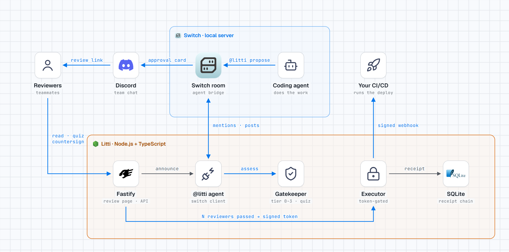
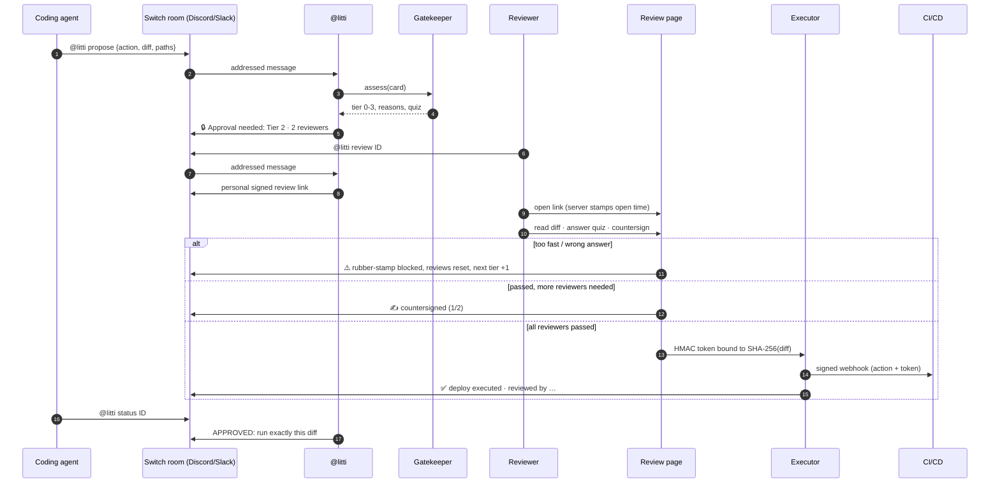

# 🔒 LITTI

[](https://github.com/Abhishek764/litti/actions/workflows/ci.yml) [](LICENSE) [](CONTRIBUTING.md)

**Your approve button is a spring lock. Litti makes sure someone turned the key.**

> Developers approve 93% of AI coding agent permission prompts. At that rate, Allow is just a slower Continue.

Litti is an approval gate that lives in your team's **Switch** room. When a coding agent wants to
do something risky (run a migration, deploy, delete data), it has to ask `@litti` first. Litti
works out how risky the action is, asks the right number of teammates to review it, makes each
reviewer prove they read the diff, and only then lets the action run. Every decision is written
to a tamper-evident receipt chain.

Built for the **Flip the Switch** hackathon (Nov 4–7, 2026).

---

## How Litti uses Switch

Switch is where the whole workflow happens. Without a Switch room there is no one to ask, no
one to review, and nothing runs (`npm start` refuses to start without Switch).

<picture>
  <source media="(prefers-color-scheme: dark)" srcset="docs/images/architecture-dark.png">
  
</picture>

<sub>Source: [docs/architecture.html](docs/architecture.html) (self-contained, open it in a browser).</sub>

| In the Switch room | What happens |
|---|---|
| `@litti propose` + JSON | Agent (or person) asks permission. Litti posts the tier, reasons and review link. |
| `@litti review <id>` | Litti replies with **your** signed review link. It records you as the reviewer, so nobody can approve under someone else's name. |
| *(automatic)* | Progress (`✍️ 1/2`), rubber-stamp warnings, and deploy results are posted back to the room. |
| `@litti status <id>` | Agent checks whether it may proceed. |
| `@litti pending` · `verify` · `stats` | Queue, tamper check of the receipt chain, reviewer attention scores. |
| `@litti approve` | Refused. Approval never happens in chat. You have to read the diff. |

Under the hood Litti is a registered Switch agent: it registers once with `POST /agents`,
long-polls `GET /agents/{id}/notifications` for messages addressed to it, and posts with
`POST /agents/{id}/message` ([src/switch/client.ts](src/switch/client.ts)).

---

## System design

### Approval flow



### Components

| Component | File | Responsibility |
|---|---|---|
| Switch client | [src/switch/client.ts](src/switch/client.ts) | Registers `@litti`, long-polls for mentions, posts into the room |
| Chat commands | [src/switch/commands.ts](src/switch/commands.ts) | `propose`, `review`, `status`, `pending`, `verify`, `stats` |
| Gatekeeper | [src/agents/gatekeeper.ts](src/agents/gatekeeper.ts), [src/rules/tiering.ts](src/rules/tiering.ts) | Deterministic tier 0–3 + quiz built from the diff's changed lines |
| Review server | [src/approval/server.ts](src/approval/server.ts), [page.ts](src/approval/page.ts) | Review page, submit flow, agent + pipeline API, dashboard data |
| Identity | [src/approval/identity.ts](src/approval/identity.ts) | Signed review links, SSO header, server-measured review time |
| Rubber-stamp detector | [src/rules/rubberstamp.ts](src/rules/rubberstamp.ts) | Too fast, wrong answer, serial rubber-stamper |
| Tokens | [src/approval/token.ts](src/approval/token.ts) | HMAC-SHA256 token bound to the diff hash and approvers |
| Executor | [src/deploy/executor.ts](src/deploy/executor.ts) | Validates and burns the token, then signed webhook or deploy record |
| Receipt chain | [src/chain/](src/chain/) | SQLite storage, SHA-256 hash-linked receipts, verification |

### Data model

- **ActionCard**: what the agent wants to do: action, description, diff, `diffHash`, touched paths, reversible, rollback plan.
- **PendingAction**: card + tier + required reviewers + quiz (answer kept server-side) + approvals so far + status.
- **ApprovalToken**: `{tokenId, actionId, diffHash, approvers, quizResults, signature}`, where `signature = HMAC(tokenId | diffHash | approvers)`.
- **Receipt**: `chainHash = SHA-256(id + previousHash + card + outcome + attentionScore)`, and each receipt points to the previous one.

---

## What Litti checks

1. **Risk tier (0–3)** from deterministic rules: critical paths (`migration`, `auth`, `prod`, `.env`…), diff size, destructive commands (`DROP`, `DELETE FROM`, `rm -rf`), irreversibility.
2. **Enough distinct reviewers**: Tier 1 = 1, Tier 2 = 2, Tier 3 = 3. The requester can't review their own action, and nobody counts twice.
3. **Comprehension quiz** generated from the diff itself ("What does `border-radius` change to?", "Which table does this migration alter?").
4. **Real reading time**, measured by the server from a signed page-open stamp. The browser's clock is never trusted.
5. **Scrolled to the end** of long diffs.
6. **Rubber-stamp detector**: too fast on a big diff, wrong quiz answer, or a serial rubber-stamper. It's blocked, announced in the room, every review on the action is reset, and the next action's tier goes up by one.
7. **Diff-bound token**: an HMAC-signed token tied to the SHA-256 of the exact approved diff. Change one byte and it's dead. Tokens are single-use.
8. **Receipt chain**: every decision is SHA-256 hash-linked to the previous one. Editing history breaks the chain visibly.

---

## Quick start (local, about 5 minutes)

**Requirements:** Node.js 20.10+, [Switch Console](https://docs.switchagents.ai/switch-rooms/getting-started) with a local server, and a chat app connected to a room.

> **First time with Switch?** Follow the step-by-step guide: [docs/switch-setup.md](docs/switch-setup.md). It covers the Discord bot, the room, registering `@litti`, adding your coding agent, and six real-world scenarios.

```bash
git clone https://github.com/Abhishek764/litti.git
cd litti
npm install
cp .env.example .env
```

Edit `.env`:

```bash
SECRET_KEY=<run: node -e "console.log(require('crypto').randomBytes(32).toString('hex'))">
SWITCH_API_URL=http://127.0.0.1:64300      # Switch Console → server address
SWITCH_REGISTRATION_KEY=<Switch Console → Settings → API keys → Create Registration Key>
```

Run the demo (three sample actions, posted into your room):

```bash
npm run demo
```

On first run Litti registers itself as the `litti` agent and saves its own credentials to
`.litti-switch.json`. **Add `litti` to your room** in Switch Console, then type `@litti help` in
the room.

No Switch handy? `npm run demo:offline` runs the same flow with room messages printed to the terminal.

Walk through the three demo scenarios: [demo/scenarios.md](demo/scenarios.md).

---

## Connect your coding agent

Give your agent this rule (in its Switch room instructions or system prompt). A copy-paste version is in [docs/agent-instructions.md](docs/agent-instructions.md).

> Before any migration, deploy, delete, or change to auth/security/prod config, ask for approval
> in this room with `@litti propose` and a JSON block, then wait. Check with
> `@litti status <id>`. Only proceed when it says **APPROVED**.

```json
{
  "action": "migrate",
  "description": "Add MFA columns to users",
  "diff": "+ALTER TABLE users ADD COLUMN mfa_enabled BOOLEAN NOT NULL DEFAULT FALSE;",
  "touchedPaths": ["migrations/20261105_add_mfa.sql"],
  "reversible": true,
  "rollbackPlan": "Remove the mfa_enabled column."
}
```

Agents that prefer HTTP can call the same flow directly. It still posts to the Switch room:

```bash
curl -X POST http://127.0.0.1:3847/api/actions \
  -H "content-type: application/json" -H "x-litti-key: $LITTI_API_KEY" \
  -d @action.json
# → { "id": "…", "tier": 2, "status": "pending", "approvalUrl": "…" }

curl -H "x-litti-key: $LITTI_API_KEY" http://127.0.0.1:3847/api/actions/<id>
# → { "status": "approved", "token": { …signed, diff-bound… } }
```

---

## Running it for your company

```bash
docker compose up -d        # uses .env, stores data in a volume, health-checked
```

or `npm start` on any Node 20.10+ host. `npm start` validates the config and refuses to start with a weak `SECRET_KEY` or without Switch.

| Variable | Purpose |
|---|---|
| `SECRET_KEY` | **Required.** 32+ random chars. Signs approval tokens, review links, view stamps. |
| `SWITCH_API_URL` | Switch agent bridge (default `http://127.0.0.1:64300`). |
| `SWITCH_REGISTRATION_KEY` | First run only: lets Litti register as the `litti` agent. |
| `SWITCH_ROOM_ID` | Optional default room; otherwise the room that last mentioned `@litti`. |
| `PUBLIC_URL` | Base URL reviewers open (use https in production). |
| `LITTI_API_KEY` | Required header `x-litti-key` for the HTTP agent/pipeline API. |
| `LITTI_IDENTITY_HEADER` | Trust a header from your SSO proxy (e.g. `x-forwarded-email`) as reviewer identity. |
| `LITTI_DEPLOY_WEBHOOK` | Approved actions are POSTed here, signed in `x-litti-signature` (HMAC-SHA256). |
| `LITTI_WEBHOOK_SECRET` | Webhook signing key (defaults to `SECRET_KEY`). |
| `LITTI_DB_PATH` | SQLite file (default `data/litti.db`). |
| `LITTI_ALLOW_SELF_ASSERTED` | `true` lets reviewers type a name. Demo only. Leave unset in production. |
| `HOST`, `APPROVAL_SERVER_PORT`, `LOG_LEVEL`, `TRUST_PROXY` | Server settings. |

**Reviewer identity**, strongest first: your SSO proxy header → a signed `@litti review` link
(bound to one action and one Switch user, expires in 30 min) → typed name (demo only).

**Wiring deploys:** point `LITTI_DEPLOY_WEBHOOK` at your CI/CD. Verify the signature, then deploy
`action.diff`. Before shipping, a pipeline can double-check with
`POST /api/tokens/verify {token, diff}`. It returns `valid: false` if the diff changed even one byte.
Example receiver: [docs/webhook-receiver.md](docs/webhook-receiver.md).

**Tuning:** add your own critical paths in [src/rules/tiering.ts](src/rules/tiering.ts) and quiz templates in [src/agents/gatekeeper.ts](src/agents/gatekeeper.ts).

### API

| Method | Path | Auth | Purpose |
|---|---|---|---|
| `POST` | `/api/actions` | `x-litti-key` | Propose an action → tier + review link (posted to Switch) |
| `GET` | `/api/actions/:id` | `x-litti-key` | Status; includes the signed token once approved |
| `POST` | `/api/tokens/verify` | `x-litti-key` | Check a token against the diff you're about to ship |
| `GET` | `/approve/:id` | review link / SSO | Review page |
| `GET` | `/api/receipts` · `/api/chain/verify` · `/api/stats` | — | Dashboard data |
| `GET` | `/healthz` | — | Health check |

---

## Guarantees

| Guarantee | Mechanism |
|---|---|
| Can't act without approval | Executor refuses without a valid, unused token |
| Can't approve as someone else | SSO header or signed, expiring, per-action review link |
| Can't approve your own request | Requester excluded; each reviewer counts once |
| Can't fake reading | Server-measured time from a signed stamp, server-side quiz check, scroll check |
| Can't swap the diff after approval | Token is bound to the diff's SHA-256 |
| Can't replay an approval | Tokens are single-use |
| Can't quietly edit history | Hash-chained receipts; `@litti verify` / dashboard detect any change |
| Rubber-stamps have a cost | Blocked, announced in the room, reviews reset, next tier +1 (persisted) |

See [SECURITY.md](SECURITY.md) for the threat model and deployment notes.

---

## Development

```bash
npm test     # typecheck + 27 checks: core flow, production hardening, Switch client (mock bridge)
```

Stack: Node.js + TypeScript · Fastify · SQLite (better-sqlite3) · Node `crypto` · plain HTML/CSS/JS. No frontend framework, no LLM in the trust path.

## Contributing

Issues and PRs are welcome. New quiz templates, tiering rules and integrations make good first contributions. Start with [CONTRIBUTING.md](CONTRIBUTING.md). Report security bypasses privately ([SECURITY.md](SECURITY.md)).

## License

[MIT](LICENSE)
