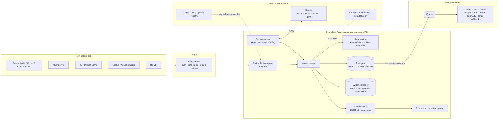
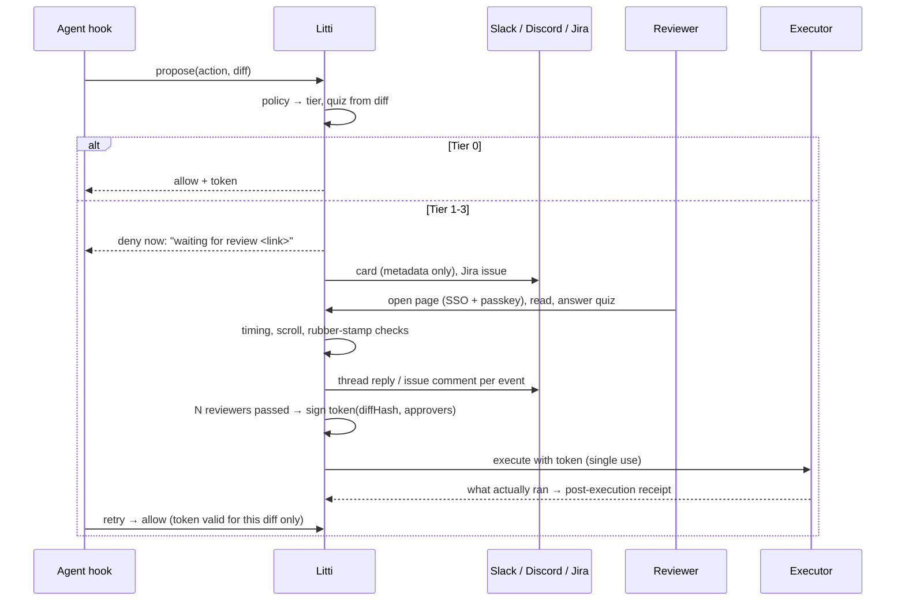

# Litti architecture — from one binary to a global service

This document describes where Litti's architecture is going. Today Litti is one Node process with SQLite.
The target is a system that runs the same way on a laptop, in a company's own cloud, and as a multi-region
hosted service, without changing the guarantees it gives:

1. **Nothing runs without proof of review.** An agent action executes only with a token bound to the exact diff a human understood.
2. **Fail closed.** If Litti is down or slow, gated actions wait. They never run unreviewed.
3. **Code stays home.** Diffs never leave the customer's chosen region, or their own network in hybrid mode.
4. **Evidence an auditor accepts.** Every decision is in a tamper-evident, independently verifiable ledger.

---

## 1. Deployment modes

| Mode | Who | Storage | Where diffs live |
|---|---|---|---|
| **Solo** (today) | One developer, CI, demos | SQLite | Local machine |
| **Self-hosted HA** | Teams that must self-host | Postgres + queue, 2+ stateless nodes | Customer network |
| **Hybrid** | Regulated enterprises | Data plane in customer VPC, control plane hosted | Customer VPC only |
| **Litti Cloud** | Everyone else | Multi-region cells | Customer's chosen region |

One codebase, one container image. The mode is configuration, not a fork.

---

## 2. System overview

### Request lifecycle

The hook **denies immediately** instead of waiting. A hook that blocks until a timeout fails open in most agents; a deny with a link never does.

---

## 3. Components

### Policy decision point (PDP)
- Stateless. Input: action, paths, environment, requester, time. Output: tier, reviewer pools, required approvers, quiz difficulty, freeze windows.
- Policy is `litti.yaml` in the repo, or a signed bundle pushed from the control plane. Bundles are Ed25519-signed so a compromised control plane can't silently loosen policy in a customer VPC.
- Decision p99 target: < 20 ms. Policies are compiled at load, never parsed per request.

### Action service
- Owns the action state machine: `proposed → pending → (countersigned)* → approved → executing → executed | failed`, plus `rejected`, `expired`, `reset (rubber-stamp)`.
- Each transition is one Postgres transaction that writes: the new state, a ledger entry, and an outbox row. That makes "the receipt says approved but Slack never heard" impossible: the outbox row commits or nothing does.
- Optimistic concurrency (`version` column) replaces today's "lock by status" so two reviewers on two nodes can't double-execute.

### Quiz engine
- Default: deterministic templates from the diff (no code leaves the process).
- Questions get harder with tier: canary lines (a fake change the reviewer must notice is not in the diff), "which file changes X", "what happens to existing rows".
- Optional LLM plug-in runs **in the same region / VPC** as the diff, behind an interface. Off by default.

### Review service
- Server-measured time (signed view stamp, already shipped), scroll, focus, and paste/automation signals.
- Step-up with **passkeys (WebAuthn)** for Tier 2+: approval requires a user-verifying authenticator, which browser-automating agents cannot satisfy.
- Approvals are never possible from chat or tickets. Slack/Discord/Jira only link to the page.

### Token service
- Today: HMAC. Target: **Ed25519** keys in a KMS/HSM, published as a JWKS, rotated every 90 days with overlap.
- Token claims: `actionId`, `diffHash`, `approvers[]` (stable ids), `policyVersion`, `issuedAt`, `exp` (≤ 15 min), `jti`.
- Single use: `jti` is burned in the executor transaction. Pipelines verify offline with the public key.

### Evidence ledger
- Per-tenant, append-only hash chain (format already shipped), with `sequence` numbers so chains never fork under concurrency.
- Hourly **Merkle checkpoint** per tenant, signed by the region key, optionally anchored to an RFC 3161 timestamp authority or a public transparency log.
- Export: JSON Lines + checkpoint proofs; `litti verify` checks a whole export offline. The receipt format is published as an open spec.
- Retention per tenant (default 7 years for regulated plans); WORM storage (S3 Object Lock) for archives.

### Integration hub
Today notifiers are in-process and best-effort. Globally that becomes:

- **Transactional outbox → queue → workers.** Queue: NATS JetStream self-hosted, SQS/PubSub in cloud.
- Every message has an idempotency key `(actionId, event, integration)`, so retries never double-post.
- Exponential backoff, per-integration rate limits (Slack tier limits, Jira 429s), dead-letter queue visible in the admin UI.
- Per-tenant secrets (Slack bot tokens, Jira tokens) encrypted with envelope encryption (KMS data keys).
- **Two-way sync**, in order: Slack interactivity endpoint (signature-verified, `Review` and `Snooze` only — never `Approve`), Jira webhook (issue closed → action rejected), PagerDuty on-call as a reviewer pool, Microsoft Teams adaptive cards, Linear, GitLab/Bitbucket checks.

| Integration | Status | Next |
|---|---|---|
| Slack app (Block Kit, threads, card closed in place) | shipped | Interactivity endpoint, user-group routing per path, DM to named reviewers |
| Discord (embeds, edit on close, pings disabled) | shipped | Forum-channel threads |
| Jira Cloud + Data Center (issue, comments, transition) | shipped | Inbound webhook, custom-field mapping, per-project routing |
| Generic webhooks | shipped | Signed payloads with `x-litti-signature` |
| Microsoft Teams, email, PagerDuty, Linear, GitHub/GitLab checks | planned | Phase 6 |

### Identity & access
- OIDC and SAML login; SCIM provisioning; orgs → teams → members.
- Roles: `owner`, `admin`, `policy-editor`, `reviewer`, `auditor` (read-only ledger), `agent` (machine identity, can only propose).
- Agents authenticate with per-agent keys or workload identity (GitHub OIDC, cloud IAM). Requester identity comes from the key, never from request text. Separation of duties is checked on stable ids.

### Executor / credential broker
- The executor holds the deploy credentials; agents never do. An approved token is exchanged for a short-lived, scoped credential for exactly that action.
- Dry-run first for Tier 2+, output shown on the review page. After execution, a second receipt records what actually ran and its hash.

---

## 4. Going global

### Cells and regions
- Cloud is split into **cells**: a full data plane (gateway, services, Postgres, queue) serving a set of tenants in one region. Regions at launch: `us-east`, `eu-central`, `ap-south`; then `ap-southeast`, `uk`.
- A tenant is pinned to one home region at signup (data residency). The global edge routes by a tenant prefix in the API key and the review URL (`eu.litti.dev/...`).
- Cells limit blast radius: an outage or a bad deploy hits one cell, never every customer.
- The control plane (identity, billing, policy registry, analytics) is global and stores **no diffs**, only metadata.

### Data placement

| Data | Where |
|---|---|
| Diffs, quiz content, review sessions | Home region only (or customer VPC) |
| Ledger + checkpoints | Home region; checkpoint hashes may be anchored publicly (hashes reveal nothing) |
| Users, orgs, billing | Global control plane |
| Rubber-stamp analytics | Aggregated, anonymised metadata |

### Availability and performance targets

| SLO | Target |
|---|---|
| Propose / decision API availability | 99.95 % per region |
| Decision API latency (Tier 0) | p99 < 150 ms at the edge |
| Review page first paint | < 1 s on 4G |
| Notification delivery | p95 < 5 s, at-least-once, deduplicated |
| Ledger durability | Synchronous replica + PITR (RPO ≤ 1 min, RTO ≤ 30 min) |

Tier 0 decisions can be served by a **local policy cache in the hook/SDK**, so the common, safe path never needs a network round trip.

### Localisation
- Review page, notifications and quiz templates are translated (ICU message format). First languages: English, Spanish, Portuguese, German, French, Japanese, Hindi.
- Quiz questions are generated from structure (files, statements, SQL verbs), so they translate without an LLM.
- RTL layout support; timestamps shown in the reviewer's time zone, stored in UTC.

---

## 5. Security model

| Threat | Control |
|---|---|
| Agent approves its own action through browser automation | Passkey step-up (Tier 2+), server-measured timing, automation signals, requester ≠ approver on stable ids |
| Diff swapped after approval (TOCTOU) | Token bound to `diffHash`; executor recomputes the hash; single-use `jti` |
| Replay of an old token | `exp`, `jti` burn, action state machine |
| Rubber-stamping | Rubber-stamp detection, tier bump, fire drills (canary actions that must be rejected) |
| Ledger tampering by an insider | Hash chain + signed Merkle checkpoints + external anchoring; auditors verify offline |
| Compromised integration token (Slack/Jira) | Integrations can't approve; tokens encrypted per tenant; least-privilege scopes |
| Compromised control plane | Policy bundles signed; data plane in hybrid mode keeps its own keys |
| Agent-supplied text injecting pings or markup | Escaping per channel (Slack mrkdwn, Discord mentions off, Jira ADF plain text) — shipped |

---

## 6. Compliance map

Litti receipts are designed to be the evidence for:

- **EU AI Act Art. 14** (human oversight of high-risk AI systems): proof a person understood and approved.
- **SOC 2 CC8.1** (change management) and **ISO 27001 A.8.32**: who approved which change, when, after what review.
- **DORA / NIS2** for financial and critical-infrastructure change control.
- **GDPR**: diffs stay in region; data processing agreement covers metadata only.

Litti Cloud itself targets SOC 2 Type II and ISO 27001 certification before enterprise launch.

---

## 7. Observability
- OpenTelemetry traces across hook → decision → review → execution, keyed by `actionId`.
- Metrics: decisions by tier, review time distribution, rubber-stamp rate, quiz pass rate, notification lag, outbox depth.
- Audit log of admin actions (policy edits, key rotations, review-link issuance) in the same ledger.

---

## 8. Migration path from today's code

Each step ships on its own and keeps `npm run demo` working with SQLite.

1. **Storage interface** over `src/chain/db.ts`; SQLite and Postgres implementations behind it.
2. **Outbox**: notifier calls become outbox rows; an in-process worker drains them (same behaviour solo, durable in HA).
3. **State machine + version column** in the action service; remove status-based locking.
4. **Ed25519 tokens + JWKS**, HMAC kept for one release for compatibility.
5. **Tenant id** on every table and API key; Postgres row-level security.
6. **Merkle checkpoints** and `litti verify --export`.
7. **OIDC login + RBAC**, then SCIM.
8. **Helm chart**, then the first cloud cell.
