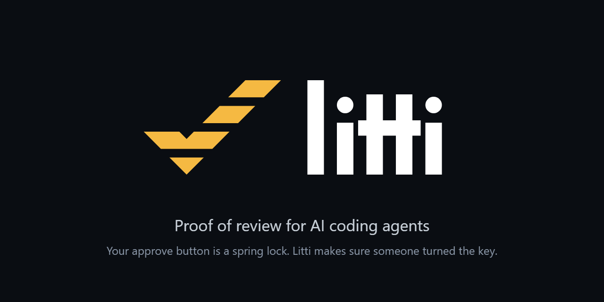
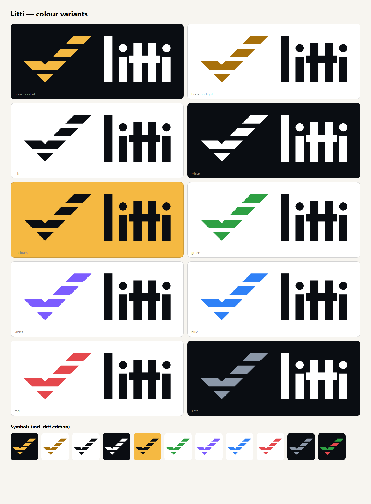

# Litti brand

<p align="center"></p>

## The idea

**The diff check.** Litti's mark is an approval built out of diff lines: a check mark sliced into
the horizontal stripes of a code diff. You only get the check by reading every line, which is what
Litti makes reviewers prove.

The wordmark **litti** is built from plain bars, like code. The two t's share one crossbar: the bolt
through the middle of the name.

## Colours

| | Name | HEX | RGB | Use |
|---|---|---|---|---|
|  | **Brass** | `#F5B942` | 245 185 66 | Primary. The symbol on dark backgrounds. The colour of a key. |
|  | **Deep brass** | `#A8700A` | 168 112 10 | The symbol on white or light backgrounds (4.2:1 on white). |
|  | **Ink** | `#0A0D12` | 10 13 18 | Dark backgrounds, the wordmark on light backgrounds, app-icon tile. |
|  | **Paper** | `#F7F5F0` | 247 245 240 | Light backgrounds. |

Brass on ink is 11:1 contrast; ink on brass is 11:1. Every colour variant below keeps the symbol at
3:1 or more against its background.

## Files

All vector files are clean single-colour paths (no live text, no effects). Use SVG wherever you can.

| File | Use |
|---|---|
| [logo/litti-horizontal-dark.svg](logo/litti-horizontal-dark.svg) | **Main logo** on dark backgrounds |
| [logo/litti-horizontal-light.svg](logo/litti-horizontal-light.svg) | **Main logo** on light backgrounds |
| [logo/litti-stacked-dark.svg](logo/litti-stacked-dark.svg) · [light](logo/litti-stacked-light.svg) | Square-ish spaces |
| [logo/litti-symbol.svg](logo/litti-symbol.svg) | Symbol on dark (brass) |
| [logo/litti-symbol-light-bg.svg](logo/litti-symbol-light-bg.svg) | Symbol on light (deep brass) |
| [logo/litti-symbol-small.svg](logo/litti-symbol-small.svg) | **Small-size cut** (3 stripes) for 32 px and below |
| [logo/litti-app-icon.svg](logo/litti-app-icon.svg) | App icon, GitHub/org avatar |
| [logo/litti-favicon.svg](logo/litti-favicon.svg) | Favicon (small cut on an ink tile) |
| [logo/litti-horizontal-dark-tight.svg](logo/litti-horizontal-dark-tight.svg) · [light](logo/litti-horizontal-light-tight.svg) | No padding, for app headers and tight layouts |
| [logo/litti-wordmark-ink.svg](logo/litti-wordmark-ink.svg) · [white](logo/litti-wordmark-white.svg) | Wordmark only |
| `logo/*-black.svg`, `logo/*-white.svg` | One-colour versions (print, embossing, partner pages) |
| [png/](png/) | PNG exports (symbol 512/1024, app icon, lockups 1200 px, social card) |
| [png/social-preview-1280x640.png](png/social-preview-1280x640.png) | GitHub social preview (Settings → Social preview) |
| [colours/](colours/) | Colour variants, SVG + PNG |

Web icons live in [`public/`](../../public/): `favicon.ico`, `favicon.svg`, `apple-touch-icon.png`,
`icon-192.png`, `icon-512.png`, `maskable-512.png`, `site.webmanifest`.

## Colour variants



| Variant | Symbol | Wordmark | Background |
|---|---|---|---|
| `brass-on-dark` (primary) | Brass | White | Ink |
| `brass-on-light` (primary) | Deep brass | Ink | White |
| `ink` | Ink | Ink | White |
| `white` | White | White | Ink |
| `on-brass` | Ink | Ink | Brass |
| `green` · `violet` · `blue` · `red` | Colour | Ink | White |
| `slate` | Slate | White | Ink |
| `diff-edition` (symbol only) | Green and red stripes, like a diff | — | Ink |

Brass is the brand. The other colours are for partner pages, themes, stickers and fun; don't use
them as the main logo.

## Usage

- **Clear space:** keep empty space around the logo at least the height of one stripe of the check.
- **Minimum size:** horizontal logo 96 px wide; symbol 24 px. At 32 px and below, use the small-size cut.
- **Backgrounds:** brass symbol on ink or dark photos; deep brass or ink on white and paper.
- **Don't:** recolour the stripes individually (except the diff edition), add shadows or gradients,
  outline the mark, rotate or skew it, change the wordmark's letters or spacing, put brass on white
  (too faint: use deep brass).

## Rebuild

Every file here is generated from [source/generate.py](source/generate.py) (Python 3, no dependencies):

```bash
python docs/brand/source/generate.py docs/brand
```

The logo is an original design for Litti. Run a trademark search before registering it.
